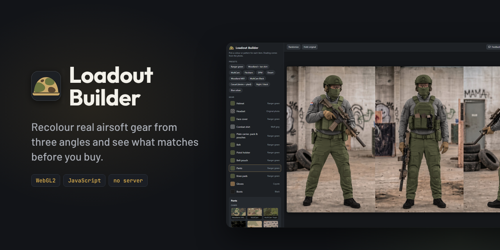

<p align="center">
  
</p>

# Loadout Builder

This app recolours your gear photos directly. There's no AI in the loop and no server.
The three angles are fixed photos. For each gear item, the app keeps the photo's
shading (folds, shadows, highlights) and swaps the colour or camo underneath it.

**Website:** [filipraic.github.io/loadout-builder](https://filipraic.github.io/loadout-builder/)

---

## Run it

Double-click `index.html`. It works straight from disk in Chrome, Edge or Firefox,
which all support WebGL2. Or use the [website](https://filipraic.github.io/loadout-builder/).

- **Presets** give you a quick starting point.
- **Gear**: click an item, then pick a pattern, a solid colour, or a custom colour.
    - *Pattern size* changes the print size for that item only.
    - *Apply to all items* copies the current choice to every item.
    - *Keep original* leaves that item as it is in the photo.
- **Add pattern image** uploads any seamless (tileable) swatch for the current session.
- **Rendering** sliders:
    - *Global pattern size* scales every print.
    - *Scene lighting* is the exposure.
    - *Match photo colour* adds the photo's warm cast.
    - *Fold warp* controls how strongly prints bend into folds.
- **Hold: original** shows the source photo while you hold the button.
- **Copy share link** puts the whole loadout in the URL.
- **Export PNG** saves the 3-angle strip at 2730×1504.
- **Feedback** opens a short form that is emailed to the maintainer (no account needed),
  optionally with a link to the current loadout and the sender's email for a reply. There's
  no server, so [FormSubmit](https://formsubmit.co/) relays it (`FEEDBACK_ENDPOINT` in
  `js/app.js`). *Send via* switches between email (the default) and a pre-filled public
  GitHub issue (needs a GitHub account). *Request it* under the patterns opens the same form.

## How it works

```
photo ──► luminance (shading) ─┐
masks (one per item) ──────────┼─► colour = swatch × (luminance / item median) ─► composite over photo
pattern/colour swatch ─────────┘       ▲ pattern lookup displaced by the blurred-shading gradient
```

- `js/renderer.js` is the WebGL2 shader that does the transfer. It runs in linear colour
  space, adds a highlight roll-off, and warps the pattern along the folds.
- `js/app.js` handles the UI, presets, share links and export.
- `js/assets.js` holds all images embedded as data URIs. Browsers block local image
  files from WebGL when a page is opened with `file://`, so the images are embedded instead.

## Asset pipeline (`tools/`, Python)

```
pip install -r tools/requirements.txt
python tools/segment.py        # first-time masks only (see Mask Editor below; --force overwrites edits)
python tools/build_assets.py   # base / shading / soft masks per angle -> assets/
python tools/build_patterns.py  # real camo + fabric swatches (downloaded) -> assets/patterns/
python tools/pack_assets.py    # embed everything into js/assets.js
```

- **Segmentation** is classical computer vision, not AI. `tools/scribbles.py` holds a few
  hand-placed seed strokes per item and angle. A random walker grows them into full
  masks, using both colour variants of the same shot (`source/`) as features.
    - To fix a mask, add or move a stroke and re-run.
    - Check the result in `tools/work/seg*.png`.
- **Patterns** are photos or scans of the real fabric, never generated. They come in two
  groups, **Camo** and **Fabric**. `build_patterns.py` lists every source in `PATTERNS`:
    - **Camo** swatches come from Wikimedia Commons. The script crops the usable area,
      evens out the lighting and stitches a seamless tile (image quilting).
    - **Fabric** swatches are photo scans from Poly Haven and ambientCG (CC0) that already tile.
    - Each entry has a physical size (`tile_cm`), turned into the `scale` in `patterns.json`
      so prints appear at a realistic size.
    - Downloads are cached in `tools/work/swatches/`. Sources, authors and licences are in
      [`assets/patterns/CREDITS.md`](assets/patterns/CREDITS.md), which the script writes.
- **Adding a pattern permanently:**
    1. Find an openly licensed photo or scan of the real pattern (a flat, evenly lit swatch works best).
    2. Add a line to `PATTERNS` in `tools/build_patterns.py` with the crop area and physical size.
    3. Run `python tools/build_patterns.py <id>` and then `pack_assets.py`.
- **Items:** helmet, headset, face cover, combat shirt, plate carrier and pack, chest
  pouches, belt, pistol holster, belt pouch, pants, knee pads, gloves, boots. The chest
  pouches always follow the plate carrier's selection (`LINKED` in `js/app.js`).
- **Items that never change:** rifle, glasses, flag patches and magazines. They always
  show as they are in the photo.
- **Where colour edges are ambiguous** (knee pads sit on similar fabric), `POLYS` in
  `scribbles.py` holds a hand-drawn outline that pins the item's shape.

## Fixing mask bleed with the Mask Editor

`tools/mask-editor.html` is a separate paint tool for the item maps. It isn't part of the
website itself.

1. Open `tools/mask-editor.html` in **Chrome or Edge**. Firefox can't write to folders.
2. Click **Open project folder…**, choose `C:\Projects\loadout-builder`, and allow editing.
   Next time you can use **Reopen**.
3. Zoom with the mouse wheel. Pan with Space+drag or right-drag.
   Switch view with **O** (fill, outline, photo only).
4. Pick the item that *should* be there with **1–9**, the list, or **Alt+click** on an
   area that already has it.
5. Fix the problem:
    - **Brush:** start the stroke inside the wrong colour and paint. With *Only repaint the
      item I start on* enabled, neighbouring items are protected.
    - **Fill (F):** reassigns a whole connected blob in one click.
    - **Edge-aware:** limits both tools to pixels whose colour is similar to where you
      started.
6. **Save & update app** (Ctrl+S) writes `tools/labels/angle*.png`, rebuilds the masks and
   `js/assets.js`, and updates `assets/meta.json`. Reload `index.html` to see the result.

The label maps in `tools/labels/` are now the source of truth. `tools/segment.py` won't
overwrite them unless you run it with `--force`, which throws away hand edits.
Running `python tools/build_assets.py` gives the same masks as the editor.

## Known limitations

- The source photos are only 455×752 per angle, so a close zoom looks soft. For a
  sharper result, re-render the base set at a higher resolution and redo the masks.
- The masks are good but not perfect. A few pixels at some item boundaries go to the
  wrong item. Fix these with extra strokes in `scribbles.py`.
- Some camo sources are small or photographed on worn fabric, so a few swatches
  (Flecktarn photo, 6-colour desert) show slight blending seams. A flat, evenly lit scan of
  the fabric makes a better source.
- Croatian digital, tiger stripe, buffalo check, houndstooth, tartan and ripstop were
  dropped because no openly licensed photo good enough was found. They can come back
  once one is.
- Some swatches are CC BY-SA or CC BY. Keep `CREDITS.md` with the app when you publish it.
- MultiCam is a trademark of Crye Precision. Fine for club use; avoid it on a commercial site.
- Prints follow the folds, but not the 3D curvature of the body. Adding a depth or
  normal map per angle would improve this.
